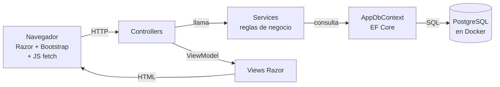
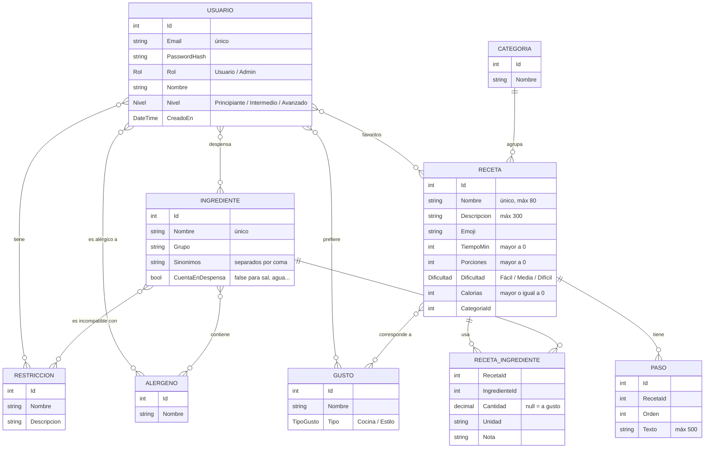

# Arquitectura de CenaAPP

Cómo está organizado el código y cómo viaja una petición. Las decisiones que la justifican están en `DECISIONES.md` (D-01 a D-08).

## 1. Capas



Recorrido de una petición (ejemplo: ver el detalle de una receta):

1. El navegador pide `GET /Recetas/Detalle/5`.
2. `RecetasController.Detalle(5)` le pide la receta a `RecetaService`.
3. `RecetaService` la busca con `db.Recetas.Include(...)` y calcula sus alérgenos desde los ingredientes.
4. EF Core traduce la consulta a SQL y PostgreSQL devuelve las filas.
5. El controller arma un `RecetaDetalleViewModel` y hace `return View(modelo)`. Si la receta no existe, devuelve la vista "no encontrado" (404).
6. Razor genera el HTML y lo manda al navegador.

En la versión JSON (`GET /api/recetas/5`) el recorrido es el mismo, pero el controller devuelve `Ok(dto)` o `NotFound(...)` en vez de una vista.

## 2. Carpetas (D-06: por capa)

```
PNT12C-YA-Grupo1/
├── CenaApp.sln
├── compose.yaml                ← PostgreSQL local
├── Dockerfile                  ← imagen para Render
├── README.md
├── docs/                       ← consigna, decisiones, errores, diseño
├── src/CenaApp.Web/
│   ├── Controllers/            reciben la petición y eligen la vista
│   │   └── Api/                controllers JSON (/api/recetas)
│   ├── Models/                 entidades (tablas)
│   ├── ViewModels/             lo que recibe cada vista / DTOs de la API
│   ├── Services/               reglas: aptitud, despensa, perfil, cuentas
│   ├── Data/                   AppDbContext, datos iniciales y Migrations/
│   ├── Views/                  una carpeta por controller + Shared/_Layout.cshtml
│   ├── wwwroot/                css/estilos.css, js/favoritos.js, js/despensa.js
│   └── Program.cs              configuración y registro de servicios
└── tests/CenaApp.Tests/        xUnit
```

| Carpeta | Qué va | Qué NO va |
|---|---|---|
| `Controllers/` | Leer la petición, validar `ModelState`, llamar al service, devolver vista/JSON | Consultas a la base, reglas de negocio |
| `Services/` | Reglas de negocio y consultas con `AppDbContext` (D-05: sin Repository) | HTML, cosas de HTTP |
| `Models/` | Clases que EF Core convierte en tablas | Lógica |
| `ViewModels/` | Datos ya preparados para una vista o respuesta JSON | `PasswordHash` ni entidades completas |
| `Data/` | `AppDbContext`, seed, migraciones | Reglas |

## 3. Controllers y services previstos

| Controller | Pantallas / endpoints | Service |
|---|---|---|
| `CuentaController` | Registro, Inicio de sesión, Cerrar sesión | `CuentaService` |
| `PerfilController` | Onboarding y Perfil (misma vista, crear/editar) | `PerfilService` |
| `RecetasController` | Inicio, Detalle, Mis favoritos, marcar favorito (`fetch`) | `RecetaService` |
| `DespensaController` | Mi Despensa, agregar/quitar (`fetch` → vista parcial) | `DespensaService` |
| `TiendasController` | Tiendas (lista fija) | `ComercioService` |
| `AdminRecetasController`, `AdminIngredientesController` | CRUD (solo rol Admin) | `RecetaService`, `IngredienteService` |
| `Api/RecetasApiController` | `GET /api/recetas`, `GET /api/recetas/{id}`, `POST`, `DELETE` | `RecetaService` |

Se ajusta durante la implementación si algo sobra; un cambio de capas se plantea como decisión nueva.

## 4. Modelo de datos (D-08)



Las relaciones `}o--o{` no tienen clase propia: EF Core crea la tabla intermedia a partir de las listas de cada entidad (por ejemplo `Usuario.Favoritos` y `Receta.UsuariosQueLaGuardaron`).

## 5. Reglas centrales (en `RecetaService` y `DespensaService`)

- **Alérgenos de una receta** = todos los alérgenos de sus ingredientes juntos (VN-04).
- **Receta apta para una restricción** = ninguno de sus ingredientes es incompatible con esa restricción.
- **Inicio:** se ocultan las recetas con algún alérgeno del usuario (VN-05) y las que no son aptas para todas sus restricciones (VN-06). Se ordenan por cantidad de gustos en común y después por nombre (VN-08).
- **Despensa:** porcentaje = ingredientes que el usuario tiene / ingredientes de la receta, sin contar los que tienen `CuentaEnDespensa = false` (VN-10). 100 % → "Podés cocinar"; 50–99 % → "Casi listas", de mayor a menor, con los faltantes.

## 6. Seguridad
- Autenticación por cookie (incluida en ASP.NET Core) y `PasswordHasher<Usuario>` para las contraseñas.
- `[Authorize]` en todo lo que requiere sesión; `[Authorize(Roles = "Admin")]` en los controllers de administración (RNF12).
- La cadena de conexión real va en variables de entorno o User Secrets, nunca en Git.
